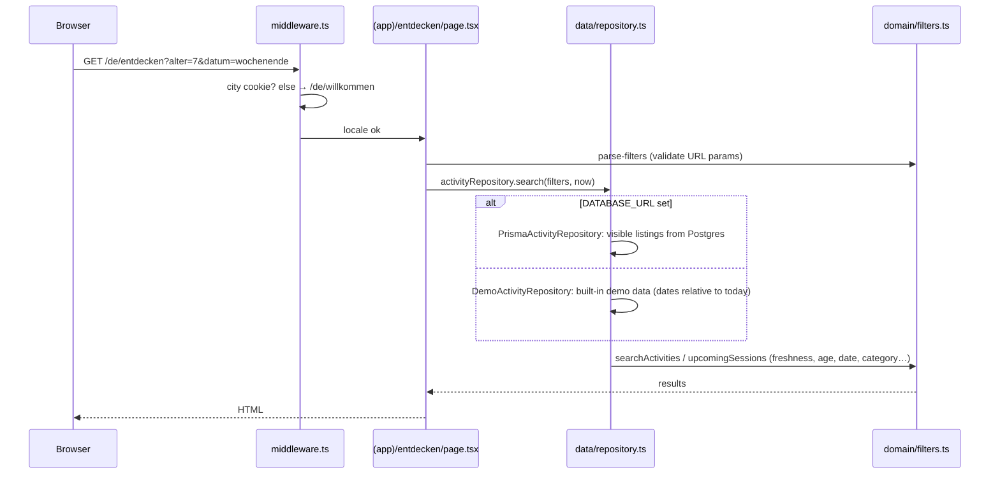

# Architecture

How Mivora is built: system context, folder structure, data flow, and the cross-cutting rules (data, auth, i18n, design, privacy, testing, deployment). This doc describes **the code as it is** (commit `af30ef3`). Why the technologies were chosen: [03-tech-stack-and-data-model.md](03-tech-stack-and-data-model.md). Decisions with their reasons: [decisions/](decisions/README.md).

_Last updated: 2026-11-25._

---

## 1. System context

```mermaid
flowchart LR
  parent([Parent / carer, phone first]) --> app
  admin([Admin]) --> app

  subgraph host["One server in Germany (prepared, not deployed)"]
    caddy[Caddy<br/>HTTPS + tester password] --> app
    app[Next.js app<br/>pages, server actions, API routes]
    db[(PostgreSQL 17)]
    disk[(Photo storage<br/>local disk)]
    jobs[Daily job 18:00<br/>reminders + "still current?"]
  end

  app -- DATABASE_URL set --> db
  app -. no DATABASE_URL .-> demo[Built-in demo data]
  app --> disk
  jobs --> db
  app --> smtp[SMTP mail<br/>Mailpit locally, EU provider later]
  app --> weather[Bright Sky API<br/>DWD rain outlook]
  browser[Browser] -. after a click .-> osm[OpenStreetMap tiles]
  browser --> unsplash[images.unsplash.com<br/>demo photos only]
```

**Style:** one Next.js 15 app (App Router), not a monorepo ([ADR-0001](decisions/0001-single-nextjs-app.md)). Pure logic lives in `src/domain` and data access sits behind a repository, so either can be split out later (e.g. for native apps).

---

## 2. Folder structure

```
Mivora-App/
├── src/
│   ├── app/
│   │   ├── [locale]/
│   │   │   ├── layout.tsx              <html lang dir>, theme, fonts, providers
│   │   │   ├── willkommen/             welcome + city picker (outside the app shell)
│   │   │   ├── anmelden/               email-code sign-in
│   │   │   ├── (app)/                  pages with header, bottom nav, footer
│   │   │   │   ├── page.tsx            Home
│   │   │   │   ├── entdecken/          Explore (list + map)
│   │   │   │   ├── aktivitaet/[slug]/  Activity detail (+ actions: report, inquiry)
│   │   │   │   ├── gemerkt/            Saved
│   │   │   │   ├── meine-woche/        Calendar
│   │   │   │   ├── profil/             Account, children, export, delete
│   │   │   │   ├── admin/              Dashboard, neu/, bearbeiten/[id]
│   │   │   │   ├── fuer-anbieter/      Info for providers
│   │   │   │   ├── ueber/              About
│   │   │   │   ├── rechtliches/[page]/ Legal placeholders
│   │   │   │   └── error.tsx, loading.tsx
│   │   │   ├── not-found.tsx, [...rest]/
│   │   ├── api/                        account/export, health, me/lists, photos/[id]
│   │   ├── app-icon/[size]/            generated PWA icons
│   │   ├── manifest.ts
│   │   └── globals.css                 design tokens (light + dark)
│   ├── components/                     UI components, illustrations/, client stores
│   ├── domain/                         pure TS: types, filters, time, calendar, ages, geo, contrast…
│   ├── data/                           repository interface, demo data, db/ (Prisma repository)
│   ├── server/                         server-only: auth/, family, lists, listings, photos, mail, jobs, weather
│   ├── i18n/                           next-intl routing, navigation, request config, message merge
│   ├── generated/prisma/               generated Prisma client (not edited by hand)
│   └── middleware.ts                   welcome redirect + locale routing
├── messages/                           de.json (source) + 8 languages
├── prisma/                             schema.prisma, migrations/, seed.ts
├── e2e/                                Playwright journeys + axe accessibility
├── public/                             sw.js, offline.html, app-preview.webp
├── design/                             editable SVG artwork for Illustrator
├── deploy/                             compose.yml, Caddyfile, backup.sh, env.example
├── scripts/daily-jobs.ts
├── Dockerfile, docker-compose.yml      production image; local Postgres + Mailpit
└── docs/
```

**Layer rule:** `app/` and `components/` → `server/` and `data/` → `domain/`. `domain/` imports nothing from the other layers (no React, Next, Prisma or I/O), so it is unit-testable.

---

## 3. Request flow

### Reading the catalogue



- **One place for visibility:** `domain/filters.ts` decides what is upcoming (published, not expired, future, not cancelled). The Prisma repository narrows in SQL first; age/date/category filters still run in app code ([05](05-implementation-plan.md), step 4 note).
- **Writes** use Server Actions next to their pages (`aktivitaet/[slug]/actions.ts`, `profil/actions.ts`, `admin/*actions.ts`). They validate input, check the signed-in user and admin rights, then call `server/*`.

---

## 4. Data

- **PostgreSQL 17 + Prisma 7** (driver adapter `@prisma/adapter-pg`, client generated to `src/generated/prisma`) ([ADR-0002](decisions/0002-repository-with-demo-fallback.md)).
- **Models:** `Provider, Venue, Activity, ActivityTranslation, Session, User, LoginCode, AuthSession, Child, SavedActivity, PlannedItem, AuditLog, Report, Inquiry`, plus the enums `ListingStatus, SessionStatus`.
- **Without `DATABASE_URL`** the app runs on built-in demo data (`data/demo-activities.ts`). Accounts, admin and anything that writes need the database.
- **Locations:** plain latitude/longitude. PostGIS is planned together with radius search.
- **Seed:** `pnpm db:seed` loads clearly marked demo listings and refuses to run against a non-local host.
- **Time:** stored in UTC. Shown in Köln time (`domain/time.ts`, `TIME_ZONE`). Dates and prices are formatted per UI language with Latin digits (Arabic uses `ar-u-nu-latn`) in `domain/format.ts`.

---

## 5. Auth and privacy

- **Sign-in:** a 6-digit code by email (`server/auth/*`), stored as an HMAC hash, valid 10 minutes, rate-limited. The session token is stored as a SHA-256 hash in the httpOnly cookie `mv_session` (30 days).
- **Admins:** emails in `ADMIN_EMAILS`. Checked server-side on every admin page and action (`isAdmin`). Non-admins get a 404.
- **Family data:** every read and write is scoped to the signed-in user (`server/family.ts`). DB tests cover cross-family access.
- **Children:** optional nickname, birth year, interests and colour only. No real names, birthdays, photos or health data.
- **What is stored where, and the cookie list:** [07-data-inventory.md](07-data-inventory.md). Keep it updated with every new field or cookie.
- **Security headers** (`next.config.ts`): `X-Content-Type-Options`, `Referrer-Policy`, `X-Frame-Options: DENY`, `Permissions-Policy`. No `X-Powered-By`.

### External services

| Service | Used for | What is sent | Note |
|---|---|---|---|
| Bright Sky (DWD open data) | Rain banner | Fixed Köln coordinates | Server-side; failure means no banner |
| OpenStreetMap tile server | Explore map | Visitor's IP (tile requests) | Only after a consent click. Production needs an EU tile provider with an agreement |
| images.unsplash.com | Demo listing photos | Visitor's IP | Demo only (Unsplash License). Real listings use uploaded photos |
| SMTP provider | Sign-in codes, inquiries, reminders, holiday ideas | Recipient email and content | Mailpit locally. EU provider + DPA before going live |

---

## 6. Design system

- **Tokens** live in `src/app/globals.css` as CSS variables (`--kw-*`), mapped to Tailwind 4 colours (`bg`, `surface`, `ink`, `muted`, `line`, `primary`, `on-primary`, `accent`, `focus`…). Components use the semantic names only ([ADR-0003](decisions/0003-brand-design-system.md)).
- **Brand colours:** Coral `#F2A68A` · Sunshine `#F3D077` · Mint `#82C3B8` · Lavender `#AF9FD5` · Cream `#FFF3EA` · Midnight Blue `#263847`.
- **Dark mode:** the same tokens get dark values when the device is dark (unless "light" was picked) or when "dark" was picked (`data-theme`). The two dark blocks must stay identical, which `domain/contrast.test.ts` checks along with text contrast.
- **Type** (`app/[locale]/layout.tsx`, via `next/font`, self-hosted): **Fredoka** for the logo and headings, **Nunito** for body text (Latin + Cyrillic), **Noto Sans Arabic** for Arabic. Fredoka has no Cyrillic or Arabic, so those headings fall back to Nunito or Noto Sans Arabic.
- **Illustrations:** original SVG drawn in code (`components/illustrations/*`). Editable copies for Illustrator are in `design/`, with an export guide in `design/README.md`. No third-party art.
- **RTL:** Arabic sets `dir="rtl"`. Use logical CSS properties.

---

## 7. Internationalisation

- **next-intl 4**, `/[locale]` prefix, 9 locales: `de` (source) plus `en ar tr uk fr es it pl` (`i18n/routing.ts`).
- **Messages:** `messages/<locale>.json`. Missing keys fall back to German (`i18n/merge.ts`), and `i18n/messages.test.ts` checks parity.
- **Client payload:** only the needed message namespaces are sent to the browser (`i18n/client-namespaces.ts`, with a test).
- **Listings:** `ActivityTranslation` per locale. The page shows the original language with a note when no translation exists.
- **Translations other than de/en are unreviewed.** They need native-speaker review before launch, especially ar, tr and uk.

---

## 8. Installable app (PWA)

`app/manifest.ts` plus icons generated by `app/app-icon/[size]`. `public/sw.js` serves an offline page and is always revalidated (`Cache-Control: no-cache`). `AppInstall.tsx` offers installation, and `GetTheApp.tsx` shows a QR card on desktop.

---

## 9. Background jobs

`pnpm jobs:daily` (`scripts/daily-jobs.ts` → `server/jobs.ts`) sends reminder emails for the evening before planned activities, and "still current?" emails to providers. In production it is scheduled at 18:00 on the server ([06](06-test-version-online.md)).

---

## 10. Testing

| Level | Tool | Command | Covers |
|---|---|---|---|
| Unit | Vitest | `pnpm test` | `domain/*` (filters, time, calendar, ages, geo, contrast), i18n parity, auth crypto, photos, lists |
| Database | Vitest + Postgres | `TEST_DATABASE_URL=… pnpm test` | family isolation (skipped without a test DB) |
| E2E + a11y | Playwright + axe | `pnpm test:e2e` | key journeys, accessibility of main pages (dev server on :3100) |

CI (`.github/workflows/ci.yml`) migrates a test database, then runs typecheck, tests and build.

---

## 11. Environments and deployment

| Env | How | Data |
|---|---|---|
| Local, no DB | `pnpm dev` | built-in demo data |
| Local, with DB | `pnpm db:up && pnpm db:migrate && pnpm db:seed && pnpm dev` | demo seed. Mailpit at `localhost:8025` |
| Demo | `pnpm demo` / `pnpm demo:phone` (local Wi-Fi) / `pnpm dev:present` | presentation mode (no dev badge) |
| Test version | `deploy/compose.yml` + Caddy on one German server, behind a tester password | demo data. **Prepared, not deployed** ([06](06-test-version-online.md)) |

The `Dockerfile` builds Next's `standalone` output on Node 22. **No accounts or paid services are created without the owner's approval.**
